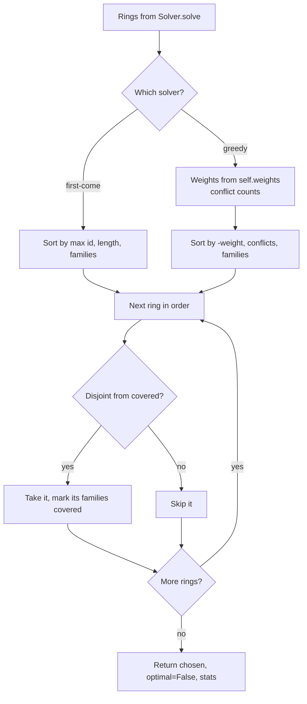
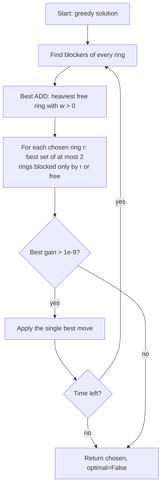
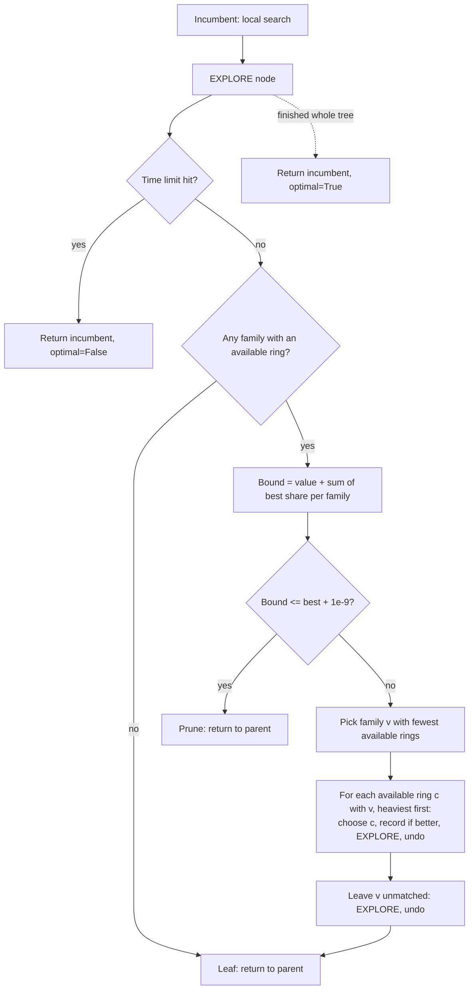

# Design · Heuristics

Owner: Heuristics · Last updated: 2026-11-09

The four rungs of the algorithm ladder, from cheapest to exact: **first-come → greedy → local search → branch and bound**. Every solver gets the list of candidate rings from `Solver.solve` and implements only `_solve(pool, cycles) -> (chosen, optimal, stats)`. Every comparison uses `w = self.weights(pool, cycles)`, never `len(c)`, so the solvers become failure-aware as soon as a different scorer is passed in.

## Modules

| File | Class (registry name) | `exact` | Phase | Status |
| --- | --- | --- | --- | --- |
| `solvers/first_come.py` | `FirstComeSolver` (`"first-come"`) | False | P1 | Done, PR #6 |
| `solvers/greedy.py` | `GreedySolver` (`"greedy"`), plus helper `conflict_counts` | False | P1 | Done, PR #6 |
| `solvers/local_search.py` | `LocalSearchSolver` (`"local-search"`) | False | P2 | Designed below |
| `solvers/branch_bound.py` | `BranchAndBoundSolver` (`"branch-bound"`), v1 and v2 | True | P2–P3 | Designed below |
| `experiments/optimality_gap.py`, `experiments/ring_length.py` | `SPEC` in each | | P4 | Not started |

Words used below:
- A ring **fits** if none of its families is already in a chosen ring.
- A family is **covered** if it is in a chosen ring.
- The **incumbent** is the best complete solution found so far.

## Pseudocode (dated)

### First-come (2026-11-09)

```text
FIRST-COME(rings):
    order  <- rings sorted by (max family id, length, families)   # max id = when the ring becomes possible
    chosen <- [], covered <- {}
    for ring in order:
        if ring's families are disjoint from covered:
            chosen.append(ring); covered.add(ring's families)
    return chosen, optimal = False, stats {rings_considered, rings_taken}
```

It ignores weights on purpose: it's the "no planning" baseline. Cost: O(R log R) to sort R rings, plus O(total ring size) for the loop.

### Greedy (2026-11-09)

```text
CONFLICT-COUNTS(rings):
    N[S] <- how many rings contain every family in S, for every subset S of every ring
    for ring in rings:                                    # inclusion-exclusion over the ring's families
        touching <- sum over nonempty subsets S of ring of (+1 if |S| odd, -1 if even) * N[S]
        conflicts[ring] <- touching - 1                   # minus the ring itself
    # for {a,b,c}: |A|+|B|+|C| - |A∩B| - |A∩C| - |B∩C| + |A∩B∩C|, so a ring sharing 2 families counts once

GREEDY(rings):
    w <- self.weights(rings)
    order <- rings sorted by (-w, conflicts, families)
    take each ring that fits, in that order (same loop as first-come)
    return chosen, optimal = False, stats {rings_considered, rings_taken}
```

The conflict tie-break prefers a ring that blocks fewer alternatives.

**Guarantee: greedy gets at least 1/L of the optimum** (L = longest ring allowed, so 1/3 for L = 3), for any non-negative weights:
- Take an optimal ring O that greedy didn't pick. When greedy reached O in its sorted order, O clashed with some ring G greedy had already taken, so w(G) ≥ w(O). Charge O to G.
- The optimal rings are disjoint, so the ones that clash with G each use a different family of G. G has at most L families, so it gets at most L charges, each worth at most w(G).
- So OPT ≤ L · (greedy's total). greedy_trap shows the gap is real: 3 against 4.

### Local search (2026-11-09)

```text
LOCAL-SEARCH(rings, time_limit):
    chosen <- GREEDY(rings)
    repeat until no move improves or time runs out:
        owner[f] <- the chosen ring covering f
        for each ring c: blockers(c) <- {owner[f] for f in c that is covered}
            free rings: blockers = {}            (usable by an ADD)
            rings blocked only by r: blockers = {r}   (usable when r is swapped out)
        best move <- none, gain 0
        ADD:  the heaviest free ring with w > 0
        SWAP: for each chosen ring r (sorted):
                  candidates <- rings blocked only by r  +  free rings
                  S <- best set of <= 2 disjoint candidates (try singles and pairs, heaviest first)
                  gain <- w(S) - w(r); keep the move if gain > 1e-9 and it beats the best so far
        apply the single best move (best-improvement, deterministic)
    return chosen, optimal = False, stats {passes, moves, timed_out}
```

- **Terminates:** every applied move raises the total weight by more than 1e-9, and there are finitely many solutions.
- **Pair search:** candidates are sorted heaviest first, so the pair loop can stop as soon as `w(a) + w(b)` can no longer beat the best set found.
- **Where it gets stuck:** a move that needs two rings taken out at once (see the pool_8 trace).

### Branch and bound v1 (2026-11-09)

```text
BNB-V1(rings, time_limit):
    order <- rings sorted by (-w, families)
    best  <- GREEDY(rings)                                  # the incumbent
    EXPLORE(i = 0, value = 0)

EXPLORE(i, value):
    while i < len(order):
        bound <- value + sum of w(c) for c in order[i:] that still fit
        if bound <= best + 1e-9: pruned += 1; return          # nothing below here can win
        if order[i] fits:
            include it; if value + w > best: best <- this solution
            EXPLORE(i + 1, value + w)                        # branch 1: include ring i
            undo it
        i <- i + 1                                           # branch 2: exclude ring i (a loop step, not a call)
```

**Exclude is a loop step, not a recursive call, on purpose.** A pool of 100 has thousands of rings. One recursive call per ring would pass Python's recursion limit of 1,000. As written, the depth is at most the number of chosen rings (at most n/2).

**Bound is valid:** any completion adds only rings from `order[i:]` that still fit, and weights are ≥ 0. **Bound is weak:** it adds up clashing rings as if they could all be chosen.

### Branch and bound v2, the stage algorithm (2026-11-09)

```text
BNB-V2(rings, time_limit):
    best <- LOCAL-SEARCH(rings)                              # stronger incumbent than v1
    available ring  = no family of it is decided yet
    EXPLORE(value = 0)

EXPLORE(value):
    nodes += 1; every 64 nodes check the clock, and on timeout return best with optimal = False
    U     <- families that still have at least one available ring
    if U is empty: return                                    # leaf
    bound <- value + SUM over u in U of  MAX over available c containing u of  w(c) / |c|
    if bound <= best + 1e-9: pruned += 1; return
    v <- the family in U with the FEWEST available rings (ties: smallest id)
    for each available ring c containing v, heaviest first:     # child type 1: v goes in ring c
        choose c; decide all of c's families
        if value + w(c) > best: best <- this solution
        EXPLORE(value + w(c))
        undo
    decide v as unmatched; EXPLORE(value); undo              # child type 2: v stays unmatched
```

**Bookkeeping that makes undo cheap:**
- `blocks[c]` = how many of ring c's families are decided. The ring is available when this is 0.
- `available[u]` = how many available rings contain u.
- "Decide f" adds 1 to `blocks` of each ring containing f. When a ring goes 0 → 1, `available` drops for its members. "Undo" does exactly the reverse.

**Why branching is complete:**
- In any solution, family v is either in exactly one ring that contains it (one child per ring), or unmatched (the last child).
- These cases don't overlap and cover everything, so every feasible solution sits in exactly one leaf.

**Why the bound is valid (H3.1 proof):**
- Take any completion: a set of disjoint available rings.
- Split each ring's weight equally among its families: `w(c) = Σ over u in c of w(c)/|c|`.
- Each family is in at most one chosen ring, so its share is at most `max over its available rings of w(c)/|c|`.
- Families in no chosen ring contribute 0, which is less than that maximum.
- So any completion's value is at most `value + Σ max-share`, the bound. Weights must be ≥ 0.

**Why most-constrained-first:** a family with 1 available ring has only 2 children. Deciding it first keeps the tree narrow, and failures show up near the root.

**Known weakness, found in testing (2026-11-03):**
- On some pools of 30, the max-share bound is far from the optimum. One pool's optimum was 12 but the root bound was 27, and 3 of 30 pools timed out at 5 s with p = 0.7.
- The cause is hub families: many families each claim their best share, but all their rings go through the same few hubs, which can only be used once.
- **Planned fix (v3, not yet tested):** a "family price" bound.
  - Give each family a price y_u ≥ 0 so that every available ring is paid for: `Σ over u in c of y_u ≥ w(c)`. Then any completion is worth at most `value + Σ y_u`, because each chosen ring is paid for by its own disjoint families. This is LP weak duality.
  - Compute the prices in two passes. Busiest families go first and pay for whole rings. A reverse pass then trims any overpayment.
  - Use `min(max-share bound, price bound)`.
- Must be measured against v2 on pools of 30–100 before 16 Nov.

## Flowchart

### First-come and greedy



### Local search



### Branch and bound v2



## Hand traces

### greedy_trap

Rings (count weight): `(0,1,2)` w=3, `(0,3)` w=2, `(1,2)` w=2. Conflicts: (0,3) → 1, (1,2) → 1, (0,1,2) → 2. Optimum: (0,3) + (1,2) = 4.

- **First-come:** arrival order is (1,2) [max 2, len 2], (0,1,2) [max 2, len 3], (0,3) [max 3]. It takes (1,2), skips (0,1,2), takes (0,3): **4**. It hits the optimum by luck.
- **Greedy:** the heaviest ring is (0,1,2), so it takes it, and both swaps clash: **3**. This is the trap.
- **Local search:** start {(0,1,2)} = 3. Swap out (0,1,2): its families plus uncovered {3} allow the pair (0,3) + (1,2) = 4, a gain of 1. Apply it. Next pass: no improving move. **4**.
- **B&B v1** (incumbent: greedy 3). Order: (0,1,2), (0,3), (1,2). 7 nodes, 2 prunes:
  1. Root, i=0: bound 0+3+2+2 = 7 > 3. Include (0,1,2), value 3 (not better than 3).
  2. Inside it, i=1: nothing fits, bound 3 ≤ 3 → **prune**.
  3. Back at root, exclude (0,1,2), i=1: bound 0+2+2 = 4 > 3. Include (0,3), value 2.
  4. Inside it, i=2: bound 2+2 = 4 > 3. Include (1,2), value 4 → **new best 4**.
  5. Back at root, i=2: bound 0+2 = 2 ≤ 4 → **prune**. Done: optimal 4.
- **B&B v2** (starting from local search's 4): the root bound is 1+1+1+1 = 4 ≤ 4, so it's pruned at the root. **1 node.** To see the tree, start from greedy's 3 instead (5 nodes, 1 prune):
  1. Root: available rings per family: 0 → 2, 1 → 2, 2 → 2, 3 → 1. Bound 4 > 3. Branch on **family 3** (fewest).
  2. Child "3 in (0,3)", value 2. Ring (0,1,2) is now blocked. Bound 2+1+1 = 4 > 3. Branch on family 1: "1 in (1,2)", value 4 → **new best 4**. Then "1 unmatched" is a leaf.
  3. Child "3 unmatched": bound 0+1+1+1 = 3 ≤ 4 → **prune**. Done: optimal 4.

### pool_8 (week-1 pool), L = 3

Rings: `(3,12)`, `(9,14)`, `(3,12,7)`, `(5,7,21)`, `(5,14,9)`. Optimum: (3,12) + (9,14) + (5,7,21) = **7**. With L = 2 it's (3,12) + (9,14) = 4.

| Scorer | First-come | Greedy | Local search | B&B v1 | B&B v2 |
| --- | --- | --- | --- | --- | --- |
| count | 7 | 6 | **6 (stuck)** | 7 (13 nodes) | 7 (7 nodes) |
| expected, p = 0.6 | 2.088 | 2.088 | 2.088 | 2.088 | 2.088 |
| expected, p = 0.9 | 5.427 | 4.374 | **4.374 (stuck)** | 5.427 | 5.427 |

- **Greedy, count:** the three 3-rings tie (w=3, 2 conflicts each), so the families tie-break picks (3,12,7) first. (5,7,21) clashes on 7, so it takes (5,14,9) next, and both swaps clash: 6.
- **Local search is stuck at 6, and this is the stage example.**
  - Swapping out (3,12,7) frees {3,12,7} plus uncovered {1,21}. Only (3,12) fits there, which is worse: 2 < 3.
  - Swapping out (5,14,9) frees {5,14,9,1,21}. Only (9,14) fits there.
  - Reaching 7 needs **both** 3-rings out at once, so that (3,12), (9,14) and (5,7,21) can go in. A 1-out move can't do that, so we need an exact method.
- **First-come gets 7** again by arrival luck: (3,12), (9,14), then (5,7,21) last.
- **At p = 0.6** every solver gets the optimum. Swaps are worth 0.72 against 0.648 for a 3-ring, so all of them prefer the two swaps.

### ring_vs_swap

Rings: (0,1) and (0,1,2).

| Scorer | Greedy, local search and both B&B versions | Why |
| --- | --- | --- |
| count | the ring (0,1,2) | 3 > 2 |
| expected, p = 0.6 | the swap (0,1) | 2·0.6² = 0.72 > 3·0.6³ = 0.648 |
| expected, p = 0.9 | the ring (0,1,2) | 3·0.9³ = 2.187 > 2·0.9² = 1.62 |

First-come takes the swap every time, because it ignores weights. At p = 0.6 the v2 root bound is 0.36 + 0.36 + 0.216 = 0.936 > 0.72, so the search does branch (3 nodes) before proving 0.72 optimal.

## Unit-test cases

**P1, done:** `tests/unit/test_first_come.py` and `tests/unit/test_greedy.py`, 15 tests, all passing on `main`'s real models, scoring and Solver base.
- The trap: first-come gets 4, greedy gets 3.
- ring_vs_swap: count picks the ring, p = 0.6 the swap, p = 0.9 the ring. First-come always takes the swap.
- Conflict counts, including a neighbour that shares two families counting once.
- Each tie-break: arrival order then length; weight, then conflicts, then families.
- Ids that aren't positions: 7, 40, 1000.
- `empty` and `no_edges`: 0 rings.
- `optimal is False`, the stats, the same answer whatever the input order, and the input list left unchanged.

**P2, planned:**
1. Local search: trap → 4; ring_vs_swap under all 3 scorers.
2. Local search ≥ greedy on 50 random pools, and ≤ the optimum.
3. Local search on pool_8 (count) → 6, stuck, with `stats["moves"] == 0`.
4. Local search returns a valid plan and `timed_out` when `time_limit_s` is tiny.
5. B&B v1: trap → 4 with `optimal is True`; pool_8 → 7; ring_vs_swap at p = 0.6 and 0.9.
6. B&B v1 equals brute force on random pools of ≤ 12 families, under count, expected and arbitrary weights including 0.
7. B&B v1 stats on the trap: `nodes == 7`, `pruned == 2`.
8. All weights 0 (p = 0): objective 0 under every solver, no crash.

**P3, planned:**
1. v2 equals the ILP on 50 pools each of 20 and 30, under both scorers (slow).
2. Time limit: n = 200 with `time_limit_s=1` returns a valid plan in under 1.5 s, with `optimal is False` and `timed_out`.
3. v2 explores fewer nodes than v1 over 10 pools of 20. In testing, it was 353 against 6,022.
4. The root bound is ≥ the optimum on every test pool. The bound is never below the true value.
5. ring_vs_swap: p = 0.6 picks the swap and p = 0.9 the ring, also with `SensitisationSurvival`.

## Decisions

1. **Ring positions, not `Cycle` objects, inside B&B.** The search reads ring weights and members millions of times, so B&B numbers the rings 0..R−1 and keeps plain lists. Positions are list indices of our own ring list, not family ids, so the "ids are not indices" rule still holds.
2. **Conflict counts by inclusion–exclusion (corrected 2026-11-09).** A plain sum over a family → rings index double-counts a neighbour that shares two families. The first fix built a set of neighbours per ring, which took 2.95 s at n = 200 and 28 s at n = 300, because each ring touches about a thousand others. Counting the rings that contain each subset and combining the counts by inclusion–exclusion gives identical counts (checked on 480 ring lists, L = 2–4) in O(rings × 2^L): 0.17 s at n = 200 and 0.69 s at n = 300.
3. **Zero-weight rings.** Greedy and first-come follow "take any ring that fits", so at p = 0 they may take rings worth 0. The objective is unchanged. Local search's ADD requires w > 0. B&B prunes them through the bound.
4. **Tolerance.** Every "better" or "prune" test uses 1e-9: improve only if `> best + 1e-9`, prune if `bound <= best + 1e-9`. This avoids loops and wrong prunes caused by float rounding.
5. **v1's exclude branch is a loop**, so Python's recursion depth stays at most n/2 (see v1).
6. **Time limits.** B&B checks the clock every 64 nodes and unwinds with an exception. The incumbent is always saved as a copy, so a timeout returns a valid plan with `optimal=False`. Local search checks the clock once per chosen ring in a pass.
7. **v2 keeps v1** behind a `version` class attribute, with `stats["version"]`, for the node-count comparison and the runtime chart.
8. **Open:** whether to add the v3 price bound. Decide after measuring it against v2 on pools of 30–100, and tell the lead, since the playbook fixes the v2 bound.
